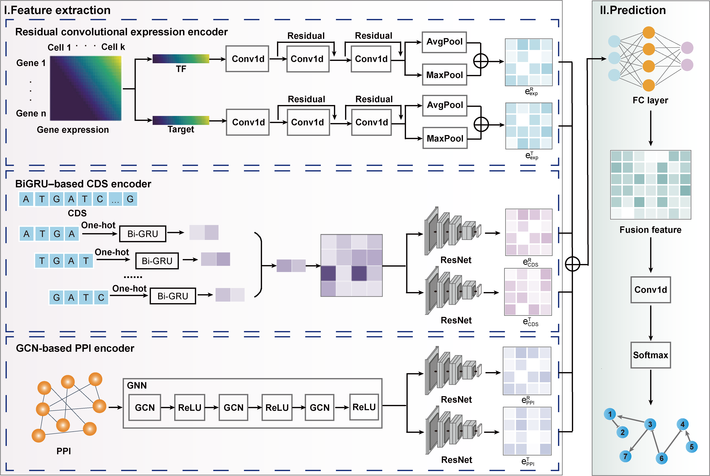

# TripGRN

Multimodal deep learning for fine-grained gene regulatory network (GRN) inference.

TripGRN directly classifies each ordered gene pair into one of three states — **activating**, **repressive**, or **non-regulatory** — by integrating gene expression profiles, coding-sequence (CDS)-derived features, and protein–protein interaction (PPI) information, without directly encoding prior regulatory topology as network input.

## Fig. 1 — Framework overview

<p align="center">
  
</p>

High-resolution source: `docs/Figure_1.tif`. Panel A–G regenerated by `grn/scripts/draw_modality_extractors_schematics.py`.

## Repository structure

```
TripGRN/
  README.md                 # This file
  AGENTS.md                 # Cursor agent working rules
  LEGACY_ROOT.txt           # Path to the read-only legacy repository
  requirements.txt          # Python dependencies
  grn/                      # Core package: models, data, training, evaluation, scripts
  shared/data/              # Curated reference data (KEGG, DoRothEA, TRRUST, STRING PPI, CDS)
  fig01_pancancer_benchmark/# Pan-cancer benchmark (KEGG + DoRothEA, 10-fold CV)
  fig02_modality_ablation/  # Modality ablation (expression / CDS / PPI)
  fig03_bulk_cross_cancer/  # Bulk RNA-seq cross-cancer evaluation
  fig04_cross_dataset_gse189357/# Cross-dataset transfer evaluation
  fig05_brain_met_case/     # LUAD brain metastasis case study
  docs/                     # Data layout, legacy map, run protocols
  tools/                    # Data bootstrap, figure organization, run helpers
```

Each `figXX_*/` folder contains:
- `scripts/` — training/evaluation/plotting scripts
- `data/` — lightweight path shims to expression/features/network data (junctions/hardlinks)
- `experiments/` — run outputs (excluded from version control)
- `figures/` — generated figures (excluded from version control)

## Quick start

1. Create the conda environment `project_GRN` and install dependencies:
   ```bash
   conda create -n project_GRN python=3.11
   conda activate project_GRN
   pip install torch torchvision torchaudio --index-url https://download.pytorch.org/whl/cu128
   pip install "tensorflow>=2.16,<2.21"
   pip install -r requirements.txt
   ```

2. Point `LEGACY_ROOT.txt` to your read-only legacy data root, then link lightweight data:
   ```bash
   python tools/bootstrap_from_legacy.py
   ```

3. Run Fig. 1 (pan-cancer benchmark) as an example:
   ```bash
   python fig01_pancancer_benchmark/scripts/run_fig01_tripgrn_kegg.py
   python fig01_pancancer_benchmark/scripts/run_fig01_tripgrn_dorothea.py
   ```

See `docs/RUN_PROTOCOL_FIG01.md` through `docs/RUN_PROTOCOL_FIG03.md` for per-figure run protocols.

## Figure pipeline

| Folder | Figure | Description |
|--------|--------|-------------|
| fig01_pancancer_benchmark | Fig. 1 | Framework overview and pan-cancer method comparison (binary & three-class) |
| fig02_modality_ablation | Fig. 2 | Expression / CDS / PPI modality ablation |
| fig03_bulk_cross_cancer | Fig. 3 | Performance across 12 TCGA bulk RNA-seq datasets |
| fig04_cross_dataset_gse189357 | Fig. 4 | Cross-dataset transfer learning |
| fig05_brain_met_case | Fig. 5 | LUAD brain metastasis regulatory network case study |

The Fig. 1 framework / modality-extractor schematics are generated by `grn/scripts/draw_modality_extractors_schematics.py`.

## Notes

- **Dataset exclusion**: `GSE145825` (prostate cancer cell line, VCaP) is **not** used in any formal result. It is excluded from Fig. 1 and all downstream plots/summaries.
- Large matrices, checkpoints, experiments, and generated figures are **not** committed. Use `tools/bootstrap_from_legacy.py` to materialize data links locally.
- The legacy repository (`E:/project/project_GRN`, recorded in `LEGACY_ROOT.txt`) is read-only and must not be modified.

## License

See `LICENSE` (if added) or contact the authors.
